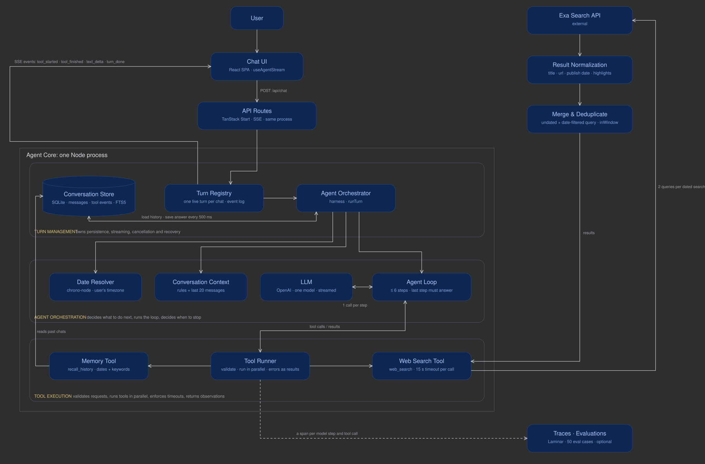

# Design: Web-Search Chat Agent

## Overview

This is a single-agent chat application with web search. The model decides when it needs external information, requests a search through a controlled tool interface, observes the results, and either searches again or produces a grounded answer.

The agent loop lives in `agent/loop.ts`. It is deliberately application-owned: the model SDK is used for a streamed model call, but the application controls tool execution, iteration limits, cancellation, persistence, and recovery.

Editable source: [docs/architecture.excalidraw](docs/architecture.excalidraw).

## How it works

1. **Start a turn.** The server creates and owns the turn lifecycle. Conversation context (rules plus the last 20 messages) is loaded before the model is called.
2. **Resolve dates.** `agent/dates.ts` interprets relative dates ("since Monday", "3 November") using the browser's timezone and hands them to the model as exact days. The harness then enforces the search window: added if the model omits it, removed if the user never asked for one, avoiding invented constraints.
3. **Plan and act.** The model can request `web_search`. The application validates each request and executes it; tool definitions do not contain model-controlled `execute` functions.
4. **Observe results.** Search results are normalized, deduplicated, and returned to the model. Independent searches run concurrently with `Promise.all`, each with its own timeout: 1.8 s for a batch of three or more, against 6.8 s one after another. A failed search becomes an error result for that call only.
5. **Continue or answer.** The model can request another search or produce a final answer. The loop is capped at six steps; on the final step, tools are disabled so the model must answer using the evidence already collected.
6. **Stream and persist.** Turn events are logged and streamed to the client over SSE. The answer is saved every 500 ms, so a refresh replays the events and continues live. Stop requests abort work server-side; interrupted turns are marked on restart.

There are two tools. `web_search` (Exa) is the only external one. `recall_history` is the agent reading its own database: SQLite with FTS5, for date-range and keyword retrieval of past conversations, rather than a vector database. When nothing matches it says so, so a fresh instance reports that it has no record instead of inventing a past conversation.

## Why this design

The first version took about **22.8 seconds to first word**. Search itself took roughly 1.6 seconds; most of the delay came from model planning and reasoning. Reducing search results from ten to five, returning concise highlights instead of full pages, lowering reasoning and verbosity, and streaming events brought first-word latency to roughly **seven seconds**. Medium reasoning increased it to around 19.5 seconds, so it was reverted.

The main design choice is to keep the agent loop explicit and small. This gives the application control over latency, parallel tool calls, timeouts, errors, cancellation, and the maximum amount of work a turn can perform. A single Node process is sufficient for the current local, single-user workload.

Date handling is explicit because date mistakes can silently make search results incomplete. Running dated and undated searches in parallel preserves useful official pages that have no publication date.

Evals use the real agent harness, an in-memory database, a fake search provider, and a fixed clock. Code checks and an LLM judge cover behavior; Laminar provides runtime observability.

| Eval set | Fully passing | LLM judge |
|---|---|---|
| Tool selection, 17 cases | 17 | |
| Time and memory, 18 cases | 17 | 0.97 to 0.99 |
| General questions, 14 cases | 10 to 12 (8 before tuning) | 0.94 to 0.96 |

Known weaknesses: recommendations sometimes under-use what the user said earlier, and an answer occasionally adds a detail its source does not state.

## Alternatives considered and rejected

- **Built-in web search:** rejected because it offered insufficient control over date filters, timeouts, and event handling.
- **Agent framework / `useChat` orchestration:** rejected in favor of a small custom loop with application-owned execution and lifecycle semantics.
- **Multiple agents:** unnecessary coordination and latency for a workflow with one external tool.
- **Vector database:** unnecessary for the current history-retrieval requirements; SQLite FTS5 is simpler and supports exact date filtering.
- **Postgres, queues, workers, and a gateway:** operational complexity without a current multi-user or multi-process requirement.
- **SSR and more elaborate infrastructure:** not justified by the current product and deployment needs.

## What I would do with another week

1. **Improve evidence quality:** fetch the full content of the one or two best search results, rather than relying only on highlights. Add stronger source-grounding and citation validation.
2. **Improve planning efficiency:** evaluate a smaller, faster planner and reduce unnecessary model round trips without sacrificing answer quality.
3. **Make recovery more durable:** persist per-step checkpoints so interrupted turns can resume safely, and make the design work across multiple processes if needed.
4. **Broaden evaluation coverage:** the first eval set was biased toward pricing and date questions, which the general set now corrects. Next: adversarial date cases, more source-attribution checks, and running the evals in CI.
5. **Improve long conversations and personalization:** summarize older turns instead of a fixed 20-message window, and make history retrieval more useful while keeping retrieved content separate from trusted system instructions.

The priority would be better evidence, faster planning, and reliable recovery, not adding more agents or infrastructure prematurely.
