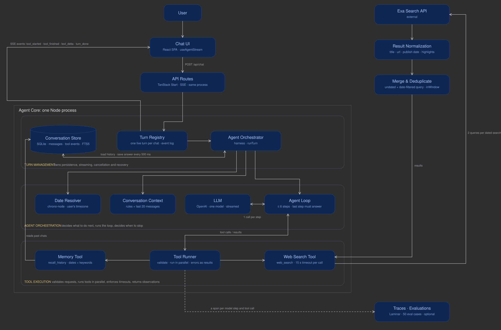

# Chat agent with web search

A chat agent you can talk to in the browser. It has one external tool, web search (Exa), plus its own memory of past conversations, so it can also answer questions like "What did I ask you on 3 November? Is your answer still correct today?"

## What it does

- **Searches the web and cites it.** Independent lookups run in parallel; sources show as numbered chips under the answer.
- **Streams as it works.** You see each search start and finish, then the answer word by word. Refresh mid-answer and it carries on; Stop keeps what was written.
- **Knows what day it is.** "Since Monday" and "last Tuesday" are resolved to exact dates in your timezone before the model runs.
- **Remembers past chats.** It can recall what you asked on a given day and check whether its answer still holds. On a fresh database it says it has no record.
- **Names each chat** with a short generated title.

How it is built and why: [DESIGN.md](DESIGN.md).



## Run it

Requires Node 22.13 or newer.

```bash
npm install
cp .env.example .env   # then fill in the keys
npm run dev            # http://localhost:3000
```

Keys in `.env`:

| Key | Needed for |
|---|---|
| `OPENAI_API_KEY` | the model |
| `OPENAI_MODEL` | which OpenAI model to use (built and measured with `gpt-5-mini`) |
| `EXA_API_KEY` | web search |
| `LMNR_PROJECT_API_KEY` | optional: tracing and evals |

The database is a local SQLite file (`data/chat.db`), created on first start. There is nothing else to set up. Delete the file to start with no history.

## How it works

```
Browser (React SPA)
  │  POST /api/chat {conversationId, text, timezone}  →  Server-Sent Events
  ▼
Agent harness (src/server/agent/)
  1. Save the user message
  2. Resolve relative dates ("since Monday", "last Tuesday") to exact days in the user's timezone
  3. Build context: system prompt (today's date, timezone, resolved dates, rules) + recent turns
  4. Loop, at most 6 model calls: model → tool calls → run them in parallel with timeouts → feed results back
     Every event is streamed to the browser and saved as it happens (a refresh mid-answer reattaches)
  5. Save the final answer
  ▼
SQLite: conversations · messages · tool_events · messages_fts (FTS5)
```

- `src/server/agent/loop.ts`: the agent loop. The AI SDK makes one streamed model call per step; the loop runs the tools itself.
- `src/server/agent/tools/web-search.ts`: Exa search. A dated search ("since Monday") runs alongside an undated one, because date filters hide pages with no publish date, such as pricing pages.
- `src/server/agent/tools/recall-history.ts`: past conversations by date range (in the user's timezone) and keywords.
- `src/server/agent/harness.ts`: one chat turn end to end; used by the HTTP route, tests and evals.
- `src/server/agent/dates.ts`: relative dates → exact days in the user's timezone (chrono-node).
- `src/server/agent/turns.ts`: running turns, independent of the browser connection (refresh, stop).
- `src/server/agent/title.ts`: a short title for each new chat, generated alongside the first answer.
- `src/client/useAgentStream.ts`: reads the event stream in the browser.

## Tests

```bash
npm test             # unit tests: offline, no API calls
npm run test:live    # calls OpenAI and Exa with your keys (a few cents)
npm run typecheck
```

## Evals

Needs `LMNR_PROJECT_API_KEY` ([Laminar](https://laminar.sh)); results and traces show in the Laminar dashboard, and a summary prints in the terminal.

```bash
npm run eval:general # 15 general questions: news, how-to, lookups, follow-ups, recommendations
npm run eval:agent   # 18 time-and-memory turns on a seeded database, including the brief's examples
npm run eval:tools   # 17 single-turn cases: which tool, which arguments
npm run eval         # all three
```

All run the real harness with a fake search engine and a fixed clock, scored by code checks and an LLM judge.

| | Cases fully passing | LLM judge | First word |
|---|---|---|---|
| General | 10 to 12 of 15 | 0.94 to 0.98 | ~6.5 s |
| Time and memory | 17/18 | 0.97 to 0.99 | ~7 s |
| Tool selection | 17/17 | | |

See [DESIGN.md](DESIGN.md) for how it works, why, and what was considered and rejected.
